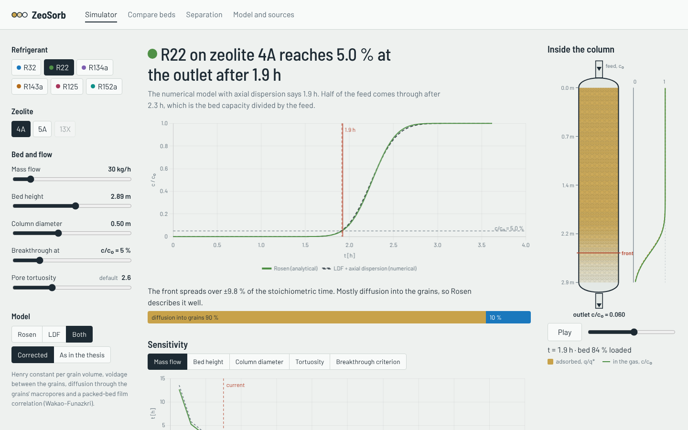
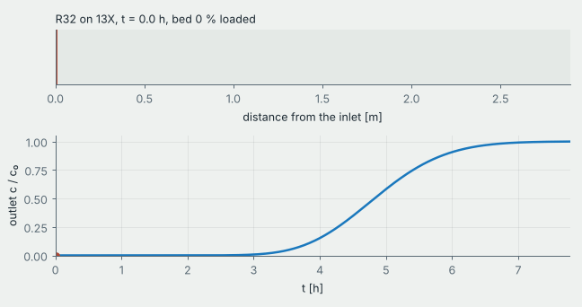
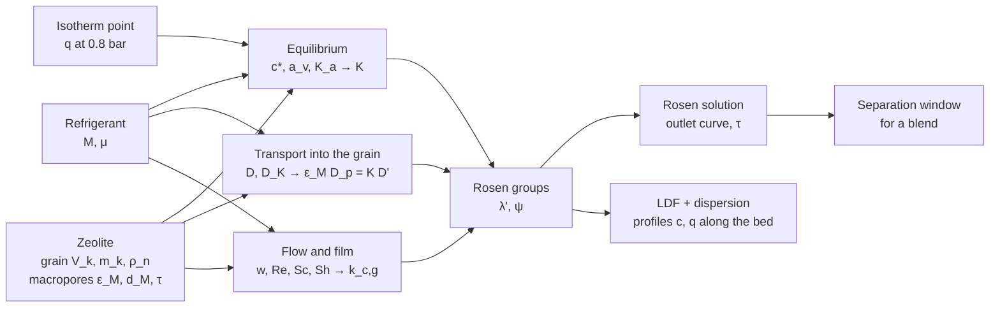
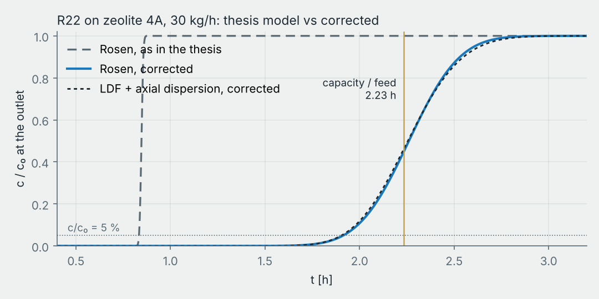

# ZeoSorb

**How long does a zeolite column hold back a refrigerant, and can it split a blend?**
A FastAPI + Angular app built around my engineering thesis at Politechnika Warszawska (MEiL, Zakład Chłodnictwa i Energetyki Budynku):

> *„Analiza procesu adsorpcji czynników chłodniczych na wybranych złożach sorpcyjnych”*
> (Analysis of refrigerant adsorption on selected sorbent beds)



## Why

Refrigerant recovered from old installations is rarely reusable as it is. Blends such as R410A, R404A or R407C are
contaminated or contain components that the EU F-gas Regulation (EU) 2024/573 phases out, R22 is banned outright, and many blends are
azeotropic, so distillation can't split them. Zeolites are molecular sieves with pores of 4–9 Å, about the size of the
refrigerant molecules themselves, which makes adsorption a candidate for separating and cleaning these streams.

The thesis estimates the **breakthrough time**: how long a column of zeolite 4A, 5A or 13X keeps one of six refrigerants
(R32, R22, R134a, R143a, R125, R152a) inside before it shows up at the outlet. All of it lived in spreadsheets.
ZeoSorb turns those spreadsheets into a model you can move with sliders, checks the analytical solution against a
numerical one, and goes one step further to the question the thesis was motivated by: separating a blend.

## What it does

| | |
|---|---|
| **Simulator** | Pick a refrigerant and a bed, move the flow, bed size, breakthrough criterion and pore tortuosity. The breakthrough curve updates live from two models: the Rosen analytical solution and a numerical LDF model with axial dispersion. A spreading budget says which mechanism widens the front, a sensitivity chart shows how the time scales with any parameter, and every intermediate value is one click away, computed as in the thesis and corrected side by side, with the source of each formula (plus CSV export). |
| **Inside the column** | The numerical model gives concentration profiles along the bed, drawn as the column itself filling up. Play it or scrub through time; the cursor on the breakthrough chart follows. |
| **Compare beds** | All 18 pairs at once as a heatmap of breakthrough time, Henry constant or front width. Pairs without isotherm data in the literature are marked, not guessed. |
| **Separation** | Two refrigerants fed as a blend (presets for R410A, R507A, R407C, R404A, R22 in R32). Shows how long the outlet carries the weaker-held component alone, and ranks the zeolites for that pair. |
| **Model and sources** | The equations, an audit of the thesis model (what changed and why), what the model leaves out, and the literature. |
| **API** | Everything above is plain JSON from `/api/v1`, with OpenAPI docs at `/docs`. |

<p align="center"></p>

## How it works



**Rosen solution** (linear isotherm, diffusion in spherical grains, external film):

$$\frac{c}{c_0} = \frac{1}{2}\left[1 + \operatorname{erf}\left(\frac{\frac{3\tau'}{2\lambda'} - 1}{2\sqrt{\frac{1+5\psi}{5\lambda'}}}\right)\right], \qquad
\lambda' = \frac{3 D' K H}{z\,w\,R^2}, \quad \psi = \frac{D' K}{R\,k_{c,g}}, \quad \tau' = \frac{2D'}{R^2}\left(t - \frac{H}{w}\right)$$

**Grains** are binder-bound beads: the gas diffuses through the macropores (molecular and Knudsen diffusion in series,
over the tortuosity) and adsorbs on the crystals on the way. For a linear isotherm that maps exactly onto Rosen's
grain diffusion:

$$K = \frac{K_a}{1-\varepsilon} + \varepsilon_M, \qquad K D' = \varepsilon_M D_p, \qquad
\frac{1}{D_p} = \tau\left(\frac{1}{D} + \frac{1}{D_K}\right), \qquad D = 1.32\,\frac{\mu}{\rho}\ \text{(Chapman–Enskog)}$$

**Numerical model** (dimensionless, $\zeta = x/H$, $\theta = tw/H$, $\kappa = K/z$):

$$\frac{\partial c}{\partial \theta} = -\frac{\partial c}{\partial \zeta} + \frac{1}{Pe}\frac{\partial^2 c}{\partial \zeta^2} - \kappa \frac{\partial q}{\partial \theta}, \qquad
\frac{\partial q}{\partial \theta} = St\,(c - q), \qquad k_{LDF} = \frac{15 D'}{R^2 (1 + 5\psi)}$$

Finite volumes with a Koren limiter, Danckwerts inlet, LSODA with a banded Jacobian, 0.5–1.5 s per run.
With that $k_{LDF}$ the numerical model has exactly the same second moment as the Rosen solution, so without
dispersion the two must agree. The test suite checks it at 5 %, 50 % and 95 % (within 1.5 %) and checks the mass balance.
Axial dispersion comes from Edwards–Richardson; the Rosen solution ignores it.

## Results at a glance

Breakthrough at c/c₀ = 5 %, column H = 2.89 m, D = 0.5 m, 30 kg/h, 100 °C, 0.8 bar, corrected mode:

| | R32 | R22 | R134a | R143a | R125 | R152a |
|---|---:|---:|---:|---:|---:|---:|
| **4A** | 3.3 h | 1.9 h | – | – | 4.2 h | – |
| **5A** | 2.4 h | 1.7 h | 2.2 h | 73 min | 2.3 h | 1.5 h |
| **13X** | 3.5 h | – | 3.4 h | 1.8 h | 3.2 h | 2.9 h |

(– means no isotherm data for that pair in the literature I found.) 4A and 13X come out close, 5A with the lowest bulk
density holds every refrigerant shortest. For blends, R410A (R32/R125) separates on every bed, best on 13X with a
clean window of about 1.6 h. R507A (R125/R143a) does not: the fronts overlap on both beds with data (α ≈ 1.2–1.3).

## Thesis audit: thesis mode and corrected mode

Rewriting the calculations and checking them against the mass balance and current adsorption literature surfaced
several things worth fixing. The default mode corrects them; `mode=thesis` keeps them, so every table in the thesis
can still be reproduced. R22 on 4A, 30 kg/h:

| | As in the thesis | Corrected | Effect |
|---|---|---|---|
| Henry constant in the Rosen groups | $K_a = a_v/c^*$ per bed volume, next to $z = \varepsilon/(1-\varepsilon)$: the bed gets only $(1-\varepsilon)$ of its capacity | per grain volume, $K = K_a/(1-\varepsilon) + \varepsilon_M$ | stoichiometric time 51 min → 2.3 h |
| Voidage | $(\rho_p-\rho_n)/\rho_p = 0.633$, which counts the zeolite micropores too | between the grains only, $1 - \rho_n/(m_k/V_k) = 0.496$, same measurements | gas velocity +28 % |
| Transport into the grain | Knudsen in the 4–9 Å window (pore size converted with 10⁻⁸ m/Å), no tortuosity | diffusion through the binder macropores, $K D' = \varepsilon_M D_p$, τ = 2.6 | $K D'$ 1.5·10⁻⁴ → 9·10⁻⁷ m²/s |
| Molecular diffusion | hard-sphere kinetic theory, two versions of the prefactor in the text and in Tab. 8 | Chapman–Enskog from the viscosity, ρD/μ = 1.32 | 8.5·10⁻⁶ → 1.0·10⁻⁵ m²/s |
| Film coefficient | Sh = 0.395 Re^0.54 Sc^0.33 with a channel diameter from the micropore surface (Re ≈ 10⁻⁴) | Wakao–Funazkri with the grain diameter | $k_{c,g}$ 0.88 → 0.015 m/s, still a minor resistance |
| E(c/c₀) | lookup table (E = −1.2 for 5 %) | exact inverse error function | E = −1.163 |



The biggest change is the capacity. The bed holds 67 kg of R22 (isotherm point × bulk density × bed volume), which at
30 kg/h is 2.23 h; corrected mode gets exactly that, thesis mode 0.85 h. The front is also three times wider: with
transport through the macropores, diffusion into the grains sets its width, while in thesis mode the front was so sharp
that axial dispersion dominated. The full list with the reasoning and sources is on the model page, and the simulator
shows every intermediate value in both modes side by side.

## Quick start

With Docker:

```bash
docker compose up --build        # http://localhost:8080
```

Without Docker, backend (Python 3.11+):

```bash
cd backend
pip install -r requirements-dev.txt
uvicorn app.main:app --reload    # http://localhost:8000/docs
pytest
```

and frontend (Node 22+):

```bash
cd frontend
npm install
npm start                        # http://localhost:4200, /api is proxied to :8000
```

## API

| Method | Path | |
|---|---|---|
| GET | `/api/v1/materials` | refrigerants, zeolites, isotherm points, blends |
| POST | `/api/v1/breakthrough` | full chain for one pair, `model = rosen \| ldf \| both`, curves, bed profiles, both modes side by side |
| GET | `/api/v1/matrix` | breakthrough time, Henry constant and front width for all pairs |
| POST | `/api/v1/separation` | two refrigerants as a blend, product window and ranking of beds |
| POST | `/api/v1/sweep` | breakthrough time against flow, bed height, diameter, tortuosity or criterion |

```bash
curl -s localhost:8000/api/v1/breakthrough \
  -H 'content-type: application/json' \
  -d '{"refrigerant": "R32", "zeolite": "13X", "mass_flow": 30, "model": "rosen"}' | jq .t_breakthrough
```

## Project structure

```
backend/
  app/core/
    materials.py     material data + bed structure derived from the thesis measurements
    transport.py     equilibrium, diffusion, Re/Sc/Sh, dispersion
    pipeline.py      the whole chain for one pair -> Bed
    audit.py         both modes side by side, with the source of each value
    rosen.py         analytical solution
    ldf.py           numerical column model
    separation.py    blend: common gas velocity, product window
  app/data/          refrigerants, zeolites, isotherm points, blends (JSON)
  app/api.py         /api/v1 routes
  tests/             values from the thesis tables, Rosen vs LDF, API
frontend/src/app/
  pages/simulator    live model + column drawing
  pages/compare      heatmap of all pairs
  pages/separation   blends
  pages/model        equations and sources
  shared/line-chart  Chart.js wrapper with markers, bands and a cursor
scripts/make_figures.py   figures in docs/img
```

## Data

- Refrigerants: molecule size measured in Avogadro on PubChem structures, viscosity at 100 °C and 0.8 bar from CoolProp.
- Zeolites 4A and 13X: grain size and mass and bulk density measured by me (thesis, chapter 4), 5A from the literature.
  The voidage between the grains follows from these; the macropores of the grains (porosity 0.27, 0.59 µm, tortuosity
  2.6) are values measured for commercial 13X beads by Hu et al. (2014), assumed for all three.
- Adsorbed amounts at 0.8 bar read from published isotherms (Wanigarathna et al. 2016, 2017), thesis Tab. 2.

## Limitations

- Single component. The separation page overlays single-component curves at the blend's gas velocity; real blends
  compete for adsorption sites and the weaker component rolls up above c/c₀ = 1. Treat the window as optimistic.
- Linear isotherm through one point at 0.8 bar, isothermal bed (no heat of adsorption).
- Undiluted feed in a model built for a trace component: the gas does not slow down as it is adsorbed. The
  stoichiometric time is a mass balance and holds; treat the width of the front as indicative.
- Diffusion inside the zeolite crystals is taken as fast. For R22 and R125 in 4A it may be the slowest step.
- Voidage measured in a small vessel, so a bit higher than in a large column; macropore data from 13X beads.
- Gas properties at 100 °C only.

## Roadmap

- [ ] Langmuir / Toth isotherms from full isotherm data, so pressure and nonlinearity matter
- [ ] competitive adsorption for blends (IAST or extended Langmuir) and roll-up in the LDF model
- [ ] non-isothermal bed (energy balance)
- [ ] regeneration step (TSA) to get a full cycle and productivity

## Versions

See [CHANGELOG.md](CHANGELOG.md). In short: `0.0.1` was a straight port of the spreadsheets, `0.0.5` added curves,
the comparison matrix and tests, `1.0.0` added the numerical model, the bed animation, blends and the corrected mode, built from an audit of the thesis model.

## References

- J. B. Rosen, *Kinetics of a fixed bed system for solid diffusion into spherical particles*, J. Chem. Phys. 20 (1952) 387.
- E. Glueckauf, *Theory of chromatography, part 10*, Trans. Faraday Soc. 51 (1955) 1540.
- M. L. Paderewski, *Procesy adsorpcyjne w inżynierii chemicznej*, WNT, Warszawa 1999.
- N. Wakao, T. Funazkri, Chem. Eng. Sci. 33 (1978) 1375.
- M. F. Edwards, J. F. Richardson, *Gas dispersion in packed beds*, Chem. Eng. Sci. 23 (1968) 109.
- D. K. J. A. Wanigarathna et al., *Adsorption separation of R-22, R-32 and R-125 fluorocarbons using 4A molecular sieve zeolite*, ChemistrySelect 1 (2016).
- D. K. J. A. Wanigarathna et al., *Adsorption separation of R134a, R125 and R143a fluorocarbon mixtures using 13X and surface-modified 5A zeolites*, AIChE J. (2017).
- S. Chapman, T. G. Cowling, *The Mathematical Theory of Non-Uniform Gases*, Cambridge University Press.
- D. M. Ruthven, *Principles of Adsorption and Adsorption Processes*, Wiley, 1984.
- J. Kärger, D. M. Ruthven, D. N. Theodorou, *Diffusion in Nanoporous Materials*, Wiley-VCH, 2012.
- X. Hu, E. Mangano, D. Friedrich, H. Ahn, S. Brandani, *Diffusion mechanism of CO₂ in 13X zeolite beads*, Adsorption 20 (2014) 121.
- S. Vasenkov, O. Geir, J. Kärger, *Gas diffusion in zeolite beds: PFG NMR evidence for different tortuosity factors in the Knudsen and bulk regimes*, Eur. Phys. J. E 12 (2003) 35.
- M. Thommes et al., *Physisorption of gases* (IUPAC Technical Report), Pure Appl. Chem. 87 (2015) 1051.
- S. Sircar, J. R. Hufton, *Why does the linear driving force model for adsorption kinetics work?*, Adsorption 6 (2000) 137.

Full list, including the thesis references with their original numbers, on the model page of the app.

## License

[MIT](LICENSE)
