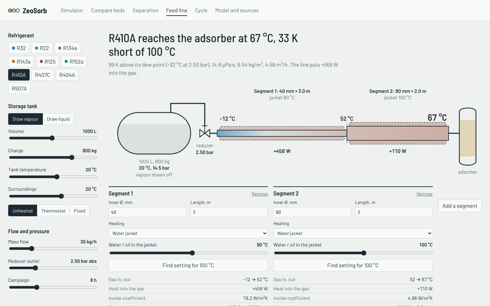
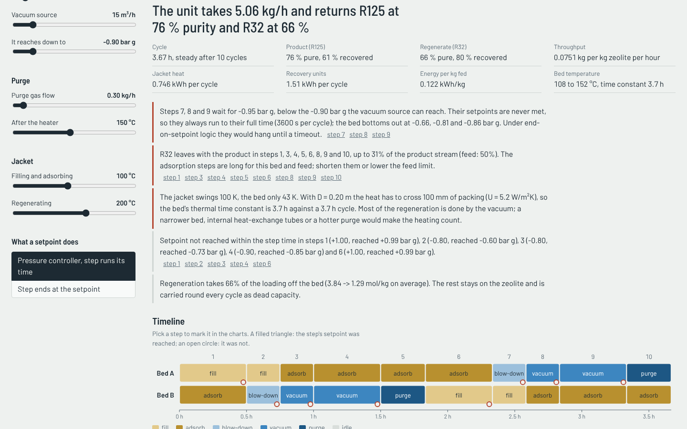
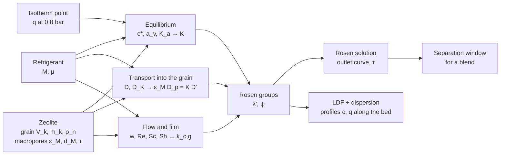
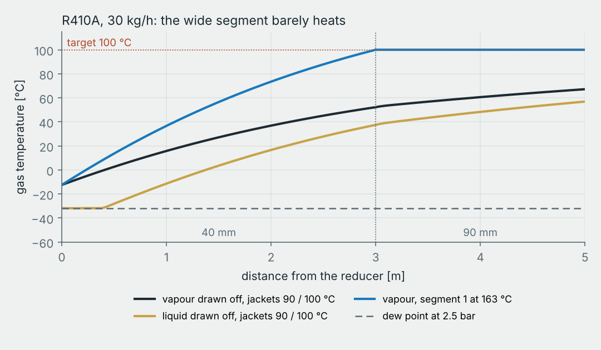
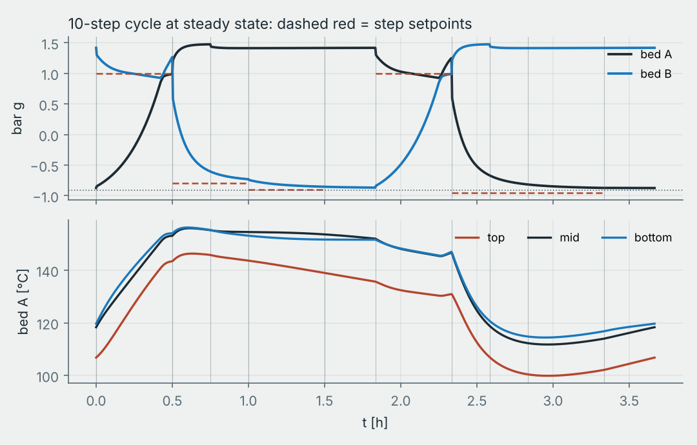

# ZeoSorb

**How long does a zeolite column hold back a refrigerant, can it split a blend, and what does it take to feed and cycle it?**
A FastAPI + Angular app built around my engineering thesis at Politechnika Warszawska (MEiL, Zakład Chłodnictwa i Energetyki Budynku):

> *„Analiza procesu adsorpcji czynników chłodniczych na wybranych złożach sorpcyjnych”*
> (Analysis of refrigerant adsorption on selected sorbent beds)


## Why

Refrigerant recovered from old installations is rarely reusable as it is. Blends such as R410A, R404A or R407C are
contaminated or contain components that the EU F-gas Regulation (EU) 2024/573 phases out, R22 is banned outright, and many blends are
azeotropic, so distillation can't split them. Zeolites are molecular sieves with pores of 4–9 Å, about the size of the
refrigerant molecules themselves, which makes adsorption a candidate for separating and cleaning these streams.

The thesis estimates the **breakthrough time**: how long a column of zeolite 4A, 5A or 13X keeps one of six refrigerants
(R32, R22, R134a, R143a, R125, R152a) inside before it shows up at the outlet. All of it lived in spreadsheets.
ZeoSorb turns those spreadsheets into a model you can move with sliders, checks the analytical solution against a
numerical one, and goes one step further to the question the thesis was motivated by: separating a blend.

## What it does

| | |
|---|---|
| **Simulator** | Pick a refrigerant and a bed, move the flow, bed size, breakthrough criterion and pore tortuosity. The breakthrough curve updates live from two models: the Rosen analytical solution and a numerical LDF model with axial dispersion. A spreading budget says which mechanism widens the front, a sensitivity chart shows how the time scales with any parameter, and every intermediate value is one click away, computed as in the thesis and corrected side by side, with the source of each formula (plus CSV export). |
| **Inside the column** | The numerical model gives concentration profiles along the bed, drawn as the column itself filling up. Play it or scrub through time; the cursor on the breakthrough chart follows. |
| **Compare beds** | All 18 pairs at once as a heatmap of breakthrough time, Henry constant or front width. Pairs without isotherm data in the literature are marked, not guessed. |
| **Separation** | Two refrigerants fed as a blend (presets for R410A, R507A, R407C, R404A, R22 in R32). Shows how long the outlet carries the weaker-held component alone, and ranks the zeolites for that pair. |
| **Feed line** | From a two-phase storage tank through a pressure reducer and heated or cooled pipe segments (by default 40 mm × 3 m, then 90 mm × 2 m) to the adsorber. Temperature, dew point, viscosity, Reynolds number and heat duty along the line, the jacket temperature or trace power that hits a target, how the tank cools and its pressure falls during a campaign, how a zeotropic blend fractionates when vapour is drawn off, and what feed temperature does to the bed's capacity. |
| **Cycle** | Two beds through a step table (fill, adsorb, blow down, evacuate, purge) until the cycle repeats itself. Non-isothermal, competitive isotherms, a shared feed header, a vacuum source with a floor, jackets that reach the packing through its radial conduction. Reports purity, recovery, energy, every step's pressures and flows, and plain-language findings: setpoints that are never reached, steps that end at once, breakthrough into the product, heating that doesn't reach the bed. |
| **Model and sources** | The equations, an audit of the thesis model (what changed and why), what the model leaves out, and the literature. |
| **API** | Everything above is plain JSON from `/api/v1`, with OpenAPI docs at `/docs`. |

<p align="center"></p>

<table>
  <tr>
    <td></td>
    <td></td>
  </tr>
  <tr>
    <td align="center">Feed line: tank, reducer and pipe segments</td>
    <td align="center">Cycle: findings and the timeline of both beds</td>
  </tr>
</table>

## How it works



**Rosen solution** (linear isotherm, diffusion in spherical grains, external film):

```math
\frac{c}{c_0} = \frac{1}{2}\left[1 + \mathrm{erf}\left(\frac{\frac{3\tau'}{2\lambda'} - 1}{2\sqrt{\frac{1+5\psi}{5\lambda'}}}\right)\right], \qquad
\lambda' = \frac{3 D' K H}{z\,w\,R^2}, \quad \psi = \frac{D' K}{R\,k_{c,g}}, \quad \tau' = \frac{2D'}{R^2}\left(t - \frac{H}{w}\right)
```

**Grains** are binder-bound beads: the gas diffuses through the macropores (molecular and Knudsen diffusion in series,
over the tortuosity) and adsorbs on the crystals on the way. For a linear isotherm that maps exactly onto Rosen's
grain diffusion:

```math
K = \frac{K_a}{1-\varepsilon} + \varepsilon_M, \qquad K D' = \varepsilon_M D_p, \qquad
\frac{1}{D_p} = \tau\left(\frac{1}{D} + \frac{1}{D_K}\right), \qquad D = 1.32\,\frac{\mu}{\rho}\ \text{(Chapman–Enskog)}
```

**Numerical model** (dimensionless, $`\zeta = x/H`$, $`\theta = tw/H`$, $`\kappa = K/z`$):

```math
\frac{\partial c}{\partial \theta} = -\frac{\partial c}{\partial \zeta} + \frac{1}{Pe}\frac{\partial^2 c}{\partial \zeta^2} - \kappa \frac{\partial q}{\partial \theta}, \qquad
\frac{\partial q}{\partial \theta} = St\,(c - q), \qquad k_{LDF} = \frac{15 D'}{R^2 (1 + 5\psi)}
```

Finite volumes with a Koren limiter, Danckwerts inlet, LSODA with a banded Jacobian, 0.5–1.5 s per run.
With that $`k_{LDF}`$ the numerical model has exactly the same second moment as the Rosen solution, so without
dispersion the two must agree. The test suite checks it at 5 %, 50 % and 95 % (within 1.5 %) and checks the mass balance.
Axial dispersion comes from Edwards–Richardson; the Rosen solution ignores it.

## Results at a glance

Breakthrough at c/c₀ = 5 %, column H = 2.89 m, D = 0.5 m, 30 kg/h, 100 °C, 0.8 bar, corrected mode:

| | R32 | R22 | R134a | R143a | R125 | R152a |
|---|---:|---:|---:|---:|---:|---:|
| **4A** | 3.3 h | 1.9 h | – | – | 4.2 h | – |
| **5A** | 2.4 h | 1.7 h | 2.2 h | 73 min | 2.3 h | 1.5 h |
| **13X** | 3.5 h | – | 3.4 h | 1.8 h | 3.2 h | 2.9 h |

(– means no isotherm data for that pair in the literature I found.) 4A and 13X come out close, 5A with the lowest bulk
density holds every refrigerant shortest. For blends, R410A (R32/R125) separates on every bed, best on 13X with a
clean window of about 1.6 h. R507A (R125/R143a) does not: the fronts overlap on both beds with data (α ≈ 1.2–1.3).

## Thesis audit: thesis mode and corrected mode

Rewriting the calculations and checking them against the mass balance and current adsorption literature surfaced
several things worth fixing. The default mode corrects them; `mode=thesis` keeps them, so every table in the thesis
can still be reproduced. R22 on 4A, 30 kg/h:

| | As in the thesis | Corrected | Effect |
|---|---|---|---|
| Henry constant in the Rosen groups | $`K_a = a_v/c^*`$ per bed volume, next to $`z = \varepsilon/(1-\varepsilon)`$: the bed gets only $`(1-\varepsilon)`$ of its capacity | per grain volume, $`K = K_a/(1-\varepsilon) + \varepsilon_M`$ | stoichiometric time 51 min → 2.3 h |
| Voidage | $`(\rho_p-\rho_n)/\rho_p = 0.633`$, which counts the zeolite micropores too | between the grains only, $`1 - \rho_n/(m_k/V_k) = 0.496`$, same measurements | gas velocity +28 % |
| Transport into the grain | Knudsen in the 4–9 Å window (pore size converted with 10⁻⁸ m/Å), no tortuosity | diffusion through the binder macropores, $`K D' = \varepsilon_M D_p`$, τ = 2.6 | $`K D'`$ 1.5·10⁻⁴ → 9·10⁻⁷ m²/s |
| Molecular diffusion | hard-sphere kinetic theory, two versions of the prefactor in the text and in Tab. 8 | Chapman–Enskog from the viscosity, ρD/μ = 1.32 | 8.5·10⁻⁶ → 1.0·10⁻⁵ m²/s |
| Film coefficient | Sh = 0.395 Re^0.54 Sc^0.33 with a channel diameter from the micropore surface (Re ≈ 10⁻⁴) | Wakao–Funazkri with the grain diameter | $`k_{c,g}`$ 0.88 → 0.015 m/s, still a minor resistance |
| E(c/c₀) | lookup table (E = −1.2 for 5 %) | exact inverse error function | E = −1.163 |


The biggest change is the capacity. The bed holds 67 kg of R22 (isotherm point × bulk density × bed volume), which at
30 kg/h is 2.23 h; corrected mode gets exactly that, thesis mode 0.85 h. The front is also three times wider: with
transport through the macropores, diffusion into the grains sets its width, while in thesis mode the front was so sharp
that axial dispersion dominated. The full list with the reasoning and sources is on the model page, and the simulator
shows every intermediate value in both modes side by side.

## Feeding the column from a two-phase tank

Recovered refrigerant comes in returnable tanks that hold liquid and vapour under their own pressure. Between the tank
and the bed there is a reducer and a few metres of pipe, and that stretch decides what the bed actually sees.



Default case: R410A from a 1000 L tank at 20 °C, 30 kg/h, reducer at 2.5 bar abs, 40 mm × 3 m with hot water at 90 °C,
then 90 mm × 2 m with water at 100 °C:

- The reducer drops saturated vapour from 14.5 bar to 2.5 bar and from 20 °C to −12 °C (Joule–Thomson). Drawn as liquid,
  it leaves the reducer at −32 °C with a vapour quality of 0.31, and segment 1 spends 2 kW evaporating it.
- The gas reaches the adsorber at 67 °C, not 100 °C. The 90 mm segment adds only 15 K: at 0.2 m/s the inside coefficient is
  5 W/m²K (NTU 0.38), so it works as a buffer. Segment 1 needs water at 163 °C (or a 270 W/m trace) to reach 100 °C;
  segment 2 alone cannot do it below 200 °C.
- Drawing vapour cools an unheated tank from 20 °C to −6 °C in 8 h and its pressure falls from 14.5 to 6.6 bar; about
  1.6 kW on the tank holds it. Drawing liquid keeps the tank steady but moves that heat into the line.
- Vapour drawn off R407C is not R407C: it carries 35 % R134a instead of 52 %. Liquid withdrawal keeps the composition.
- Viscosity follows temperature (10.8 µPa·s at −22 °C to 16.2 µPa·s at 100 °C for R410A at 2.5 bar) and changes the bed's
  Reynolds number and pressure drop only in that ratio. What the feed temperature really changes is capacity, and the
  limit on the cold side is the dew point plus a margin.

## Cycle analysis



The cycle page runs the step table of a two-bed unit: by default a typical 10-step sequence (filling, final filling,
adsorption I–IV, blowdown, desorption I–II, purge) with round example times and setpoints, on a 0.2 m × 1.0 m column of
13X fed with R410A. While bed A fills and adsorbs, bed B is blown down, evacuated, purged and refilled, then they swap.
The table is editable, and a setpoint can mean either a pressure controller target (the step runs its time) or the
condition that ends the step. The beds use the same corrected bed structure and macropore kinetics as the breakthrough
pages.

At steady state, with the defaults:

- 5.1 kg/h of R410A in; R125 comes out at 76 % purity (61 % recovered), the regenerate is 66 % R32 (80 % recovered).
- R32 slips into the product in most steps, up to 31 % of the product stream: for this bed and feed the adsorption steps
  are long, and the page says so.
- Filling and adsorption IV stop at +0.99 bar g, just short of their +1.00 bar g target in 1800 s.
- Blowdown and desorption I–II wait for −0.95 bar g, below the −0.90 bar g the vacuum source reaches, so they always run
  their full 3600 s and would hang under end-on-setpoint logic.
- The jacket swings 100 K, the bed only 43 K: across 100 mm of packing U = 5.2 W/m²K and the thermal time constant is 3.7 h,
  as long as the cycle. The bed even cools during blowdown and desorption I (the heat of desorption outruns the jacket), so
  most of the regeneration is done by the vacuum; a third of the loading stays on the zeolite from cycle to cycle.

The isotherm parameters behind this (saturation capacity, heat of adsorption) are estimates anchored to the thesis
points; the cycle model is meant for comparing settings and spotting problems in a sequence, not for sizing.

## Quick start

With Docker:

```bash
docker compose up --build        # http://localhost:8080
```

Without Docker, backend (Python 3.11+):

```bash
cd backend
pip install -r requirements-dev.txt
uvicorn app.main:app --reload    # http://localhost:8000/docs
pytest
```

and frontend (Node 22+):

```bash
cd frontend
npm install
npm start                        # http://localhost:4200, /api is proxied to :8000
```

## API

| Method | Path | |
|---|---|---|
| GET | `/api/v1/materials` | refrigerants, zeolites, isotherm points, blends |
| POST | `/api/v1/breakthrough` | full chain for one pair, `model = rosen \| ldf \| both`, curves, bed profiles, both modes side by side |
| GET | `/api/v1/matrix` | breakthrough time, Henry constant and front width for all pairs |
| POST | `/api/v1/separation` | two refrigerants as a blend, product window and ranking of beds |
| POST | `/api/v1/sweep` | breakthrough time against flow, bed height, diameter, tortuosity or criterion |
| GET | `/api/v1/process/defaults` | default feed line and cycle setups, step presets |
| POST | `/api/v1/feed` | tank campaign, reducer, line profiles, outlet state, capacity against feed temperature |
| POST | `/api/v1/feed/solve` | jacket temperature or trace power of one segment for a target outlet temperature |
| POST | `/api/v1/cycle` | two-bed cycle to cyclic steady state: steps, time series, KPIs, findings |

```bash
curl -s localhost:8000/api/v1/breakthrough \
  -H 'content-type: application/json' \
  -d '{"refrigerant": "R32", "zeolite": "13X", "mass_flow": 30, "model": "rosen"}' | jq .t_breakthrough
```

## Project structure

```
backend/
  app/core/
    materials.py     material data + bed structure derived from the thesis measurements
    transport.py     equilibrium, diffusion, Re/Sc/Sh, dispersion
    pipeline.py      the whole chain for one pair -> Bed
    audit.py         both modes side by side, with the source of each value
    rosen.py         analytical solution
    ldf.py           numerical column model
    separation.py    blend: common gas velocity, product window
    fluids.py        CoolProp: pure fluids, pseudo-pure blends, mixture VLE
    tank.py          two-phase storage tank over a campaign
    feedline.py      reducer + heated / cooled pipe segments, setting solver
    feed.py          tank + line + capacity, findings
    isotherms.py     temperature-dependent extended Langmuir
    cycle.py         two-bed non-isothermal cycle, steady state, findings
  app/data/          refrigerants, zeolites, isotherm points, blends, isotherm estimates, step presets (JSON)
  app/api.py         /api/v1 routes (breakthrough, matrix, separation, sweep)
  app/api_process.py /api/v1 routes (feed, cycle)
  tests/             values from the thesis tables, Rosen vs LDF, API
frontend/src/app/
  pages/simulator    live model + column drawing
  pages/compare      heatmap of all pairs
  pages/separation   blends
  pages/feed         tank -> reducer -> pipe -> adsorber
  pages/cycle        step table, timeline, traces, findings
  pages/model        equations and sources
  shared/line-chart  Chart.js wrapper with markers, bands and a cursor
scripts/make_figures.py   figures in docs/img
```

## Data

- Refrigerants: molecule size measured in Avogadro on PubChem structures, viscosity at 100 °C and 0.8 bar from CoolProp.
- Zeolites 4A and 13X: grain size and mass and bulk density measured by me (thesis, chapter 4), 5A from the literature.
  The voidage between the grains follows from these; the macropores of the grains (porosity 0.27, 0.59 µm, tortuosity
  2.6) are values measured for commercial 13X beads by Hu et al. (2014), assumed for all three.
- Adsorbed amounts at 0.8 bar read from published isotherms (Wanigarathna et al. 2016, 2017), thesis Tab. 2.
- Feed line and cycle: all fluid properties from CoolProp (pure fluids, pseudo-pure blends, true mixtures for VLE).
- Isotherm temperature dependence: saturation capacity from the zeolite's micropore volume over the liquid molar volume,
  heat of adsorption 1.6 × heat of vaporisation (`backend/app/data/isotherms.json`, overridable).

## Limitations

- The breakthrough pages (simulator, compare, separation) use one refrigerant, a linear isotherm through one point and a
  constant temperature. The separation window there is optimistic: real blends compete for sites and roll up.
- Undiluted feed in a model built for a trace component: the gas does not slow down as it is adsorbed. The
  stoichiometric time is a mass balance and holds; treat the width of the front as indicative.
- The cycle model has competition and heat effects, but its isotherm parameters are estimates, the pressure is uniform
  along the bed, and the radial temperature profile is lumped into one heat-transfer coefficient.
- Diffusion inside the zeolite crystals is taken as fast. For R22 and R125 in 4A it may be the slowest step.
- Voidage measured in a small vessel, so a bit higher than in a large column; macropore data from 13X beads.
- Pipe flow of blends uses pseudo-pure fluids, so the glide inside the evaporating section is approximated.
- The breakthrough pages take gas properties at 100 °C only.

## Roadmap

- [x] non-isothermal bed with temperature-dependent isotherms (cycle model)
- [x] regeneration steps and a full two-bed cycle with productivity and energy
- [x] competitive adsorption (extended Langmuir) in the cycle model
- [ ] fit Langmuir / Toth parameters to measured isotherms at several temperatures
- [ ] IAST for blends, roll-up in the breakthrough pages
- [ ] radial temperature profile in wide beds, internal heat-exchange tubes
- [ ] pressure drop along the bed (Ergun) in the cycle model

## Versions

See [CHANGELOG.md](CHANGELOG.md). In short: `0.0.1` was a straight port of the spreadsheets, `0.0.5` added curves,
the comparison matrix and tests, `1.0.0` added the numerical model, the bed animation, blends and the corrected mode, built
from an audit of the thesis model, and `1.1.0` added the feed line from a two-phase tank and the two-bed cycle.

## References

- J. B. Rosen, *Kinetics of a fixed bed system for solid diffusion into spherical particles*, J. Chem. Phys. 20 (1952) 387.
- E. Glueckauf, *Theory of chromatography, part 10*, Trans. Faraday Soc. 51 (1955) 1540.
- M. L. Paderewski, *Procesy adsorpcyjne w inżynierii chemicznej*, WNT, Warszawa 1999.
- N. Wakao, T. Funazkri, Chem. Eng. Sci. 33 (1978) 1375.
- M. F. Edwards, J. F. Richardson, *Gas dispersion in packed beds*, Chem. Eng. Sci. 23 (1968) 109.
- D. K. J. A. Wanigarathna et al., *Adsorption separation of R-22, R-32 and R-125 fluorocarbons using 4A molecular sieve zeolite*, ChemistrySelect 1 (2016).
- D. K. J. A. Wanigarathna et al., *Adsorption separation of R134a, R125 and R143a fluorocarbon mixtures using 13X and surface-modified 5A zeolites*, AIChE J. (2017).
- S. Chapman, T. G. Cowling, *The Mathematical Theory of Non-Uniform Gases*, Cambridge University Press.
- D. M. Ruthven, *Principles of Adsorption and Adsorption Processes*, Wiley, 1984.
- J. Kärger, D. M. Ruthven, D. N. Theodorou, *Diffusion in Nanoporous Materials*, Wiley-VCH, 2012.
- X. Hu, E. Mangano, D. Friedrich, H. Ahn, S. Brandani, *Diffusion mechanism of CO₂ in 13X zeolite beads*, Adsorption 20 (2014) 121.
- S. Vasenkov, O. Geir, J. Kärger, *Gas diffusion in zeolite beds: PFG NMR evidence for different tortuosity factors in the Knudsen and bulk regimes*, Eur. Phys. J. E 12 (2003) 35.
- M. Thommes et al., *Physisorption of gases* (IUPAC Technical Report), Pure Appl. Chem. 87 (2015) 1051.
- S. Sircar, J. R. Hufton, *Why does the linear driving force model for adsorption kinetics work?*, Adsorption 6 (2000) 137.
- I. H. Bell et al., *Pure and pseudo-pure fluid thermophysical property evaluation and the open-source thermophysical property library CoolProp*, Ind. Eng. Chem. Res. 53 (2014) 2498.
- V. Gnielinski, Int. Chem. Eng. 16 (1976) 359; K. E. Gungor, R. H. S. Winterton, Chem. Eng. Res. Des. 65 (1987) 148; M. M. Shah, Int. J. Heat Mass Transfer 22 (1979) 547; S. W. Churchill, Chem. Eng. 84 (1977) 91.
- D. M. Ruthven, S. Farooq, K. S. Knaebel, *Pressure Swing Adsorption*, VCH, 1994.
- S. Savitz et al., *Adsorption of hydrofluorocarbons HFC-134 and HFC-134a on X and Y zeolites*, J. Phys. Chem. B 103 (1999) 8283.

Full list, including the thesis references with their original numbers, on the model page of the app.

## License

[MIT](LICENSE)
